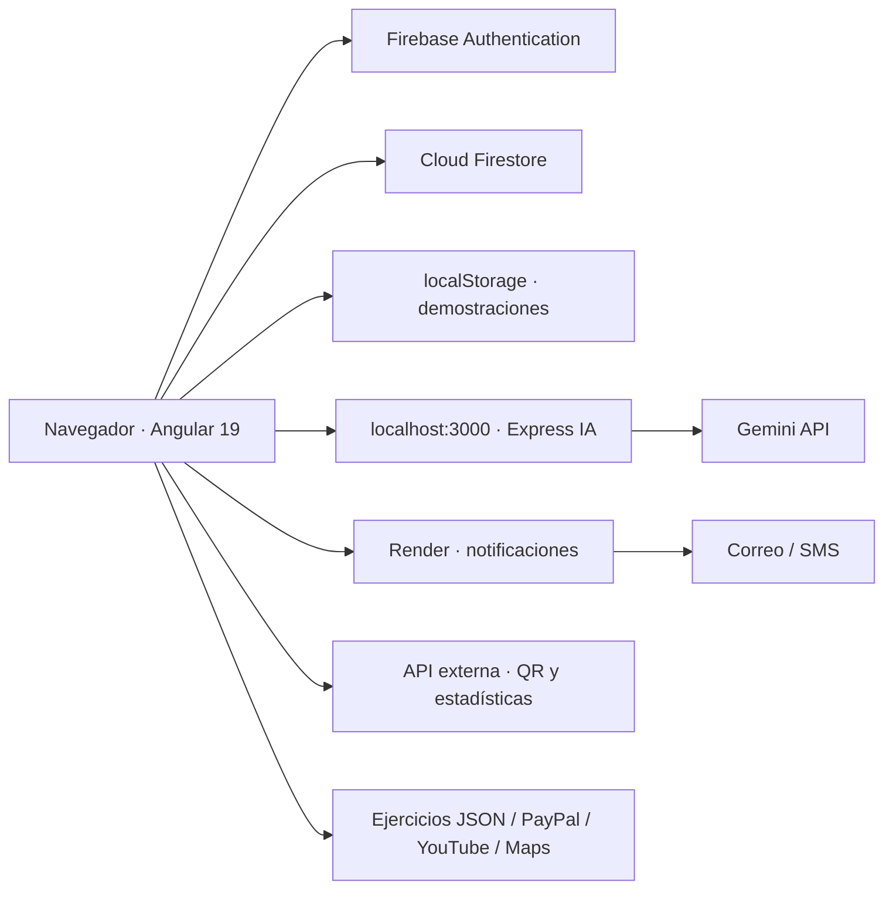
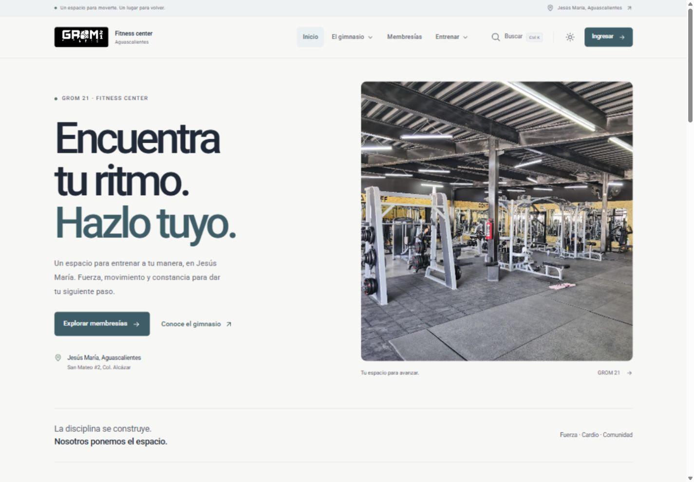
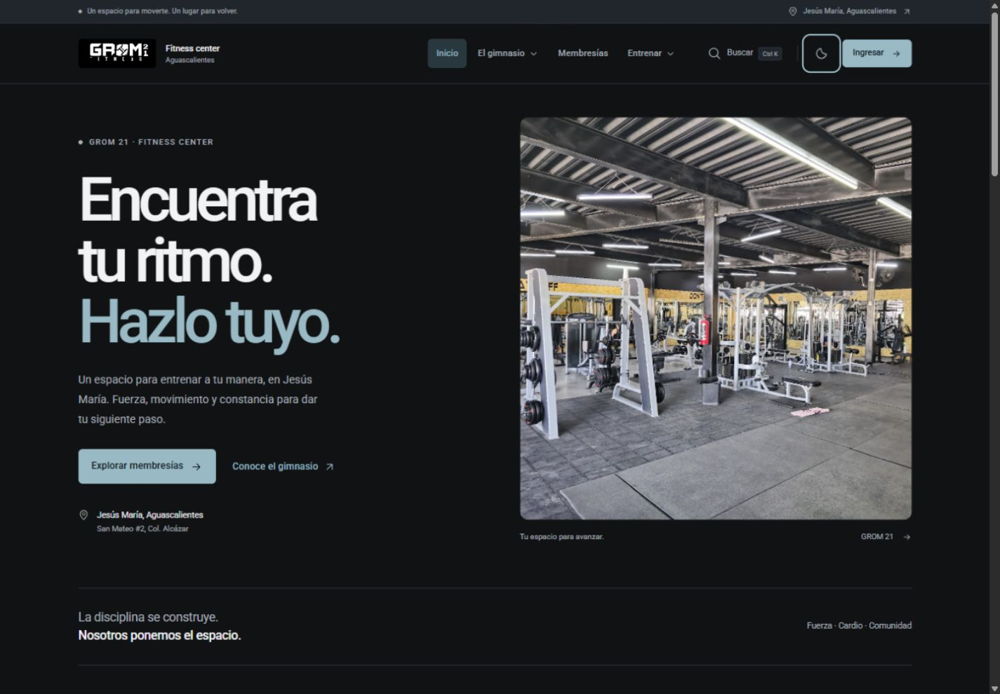

# GROM 21 · espacioGYM · GymSeminario

Plataforma web académica para un gimnasio: información pública, cursos, ejercicios, autenticación, reservas, asistencias, membresías, estado de cuenta, actividad y coach virtual con Gemini.

**Documentación actualizada: 27 de octubre de 2026, zona America/Mexico_City.** Describe el checkout y las tres fases del rediseño frontend. Las secciones 14–16 detallan cambios, verificaciones y límites; no acreditan operaciones reales de los proveedores externos.

El nombre técnico del proyecto Angular es `libreria1`; el producto se presenta como GROM 21 y espacioGYM. Ese identificador determina los comandos de Angular y la carpeta de compilación.

## 1. Inicio rápido: ver la web

Abrir una terminal PowerShell en la raíz del repositorio:

```powershell
Set-Location 'C:\Users\mhuba\Documents\GitHub\GymSeminario'
npm ci
npm start
```

Abrir [http://localhost:4200](http://localhost:4200). La ruta inicial redirige a `/home`. Mantener la terminal abierta; Angular recompila al guardar cambios. Detener con `Ctrl+C`. Después de la primera instalación, normalmente basta con `npm start`.

**No es necesario iniciar Express para visualizar la interfaz pública.** Firebase, videos, mapas, imágenes y otras integraciones necesitan conexión y configuración externa. Las vistas locales de demostración pueden mostrar información sin un backend propio.

### Requisitos

- Node.js **22.x** y npm para desarrollo local. Angular 19.2 admite Node 22 según su [tabla oficial de compatibilidad](https://angular.dev/reference/versions).
- Git y un navegador actual.
- Conexión para descargar dependencias y acceder a proveedores.
- Acceso autorizado al proyecto Firebase para probar identidad y datos remotos.

Los Dockerfiles y el workflow actuales usan Node 20; no se han actualizado en esta revisión. La documentación oficial ya incluye Angular 19 entre las versiones sin soporte; una futura actualización del framework debe planearse por separado.

Comprobar el entorno con `node --version` y `npm --version`. No hace falta instalar Angular CLI globalmente: `npm start` usa la versión local.

Si `npm ci` falla, revisar el mensaje y la coincidencia entre `package.json` y el lock. No sustituirlo automáticamente por una instalación forzada ni eliminar archivos sin revisar la causa.

## 2. Iniciar el coach IA

El frontend llama directamente a `http://localhost:3000/api`. Para utilizar rutinas y chat se necesita un segundo proceso.

1. Instalar las dependencias de la raíz con `npm ci`.
2. Preparar un `.env` en la **raíz** con una clave Gemini autorizada. Si ya existe, conservar su contenido y agregar únicamente lo necesario; no sobrescribirlo.

```dotenv
GEMINI_API_KEY=TU_CLAVE_PRIVADA
# Opcional: usar un identificador habilitado para tu cuenta.
# GEMINI_MODEL=IDENTIFICADOR_DEL_MODELO
```

3. En otra terminal PowerShell, desde la raíz:

```powershell
Set-Location 'C:\Users\mhuba\Documents\GitHub\GymSeminario'
$env:PORT = '3000'
npm run server
```

4. Comprobar [http://localhost:3000/api/health](http://localhost:3000/api/health) y abrir [http://localhost:4200/coach-ia](http://localhost:4200/coach-ia).

`server/index.js` importa `dotenv/config`: cuando se ejecuta desde la raíz, carga el `.env` de esa carpeta. El SDK de Gemini se inicializa al importar los servicios; una clave ausente o inválida puede impedir el arranque o las consultas. El endpoint de salud indica que Express responde, no que una solicitud real a Gemini haya funcionado.

**Particularidad de la estructura actual:** `server/package.json` solo declara nombre, versión y módulos ES; las dependencias necesarias están en el `package.json` principal. En ejecución local, Node las resuelve desde `node_modules` de la raíz. Instalar solamente dentro de `server/` no prepara un backend independiente.

El modelo predeterminado escrito en ambos servicios es `gemini-3.5-flash-lite`. Esto describe el código, no confirma que Google lo tenga disponible para tu cuenta; puede sobrescribirse con `GEMINI_MODEL` y debe validarse con el proveedor.

## 3. Backend de notificaciones: opcional para inspección local

Existe un segundo servidor Express en `back/`, para correo y SMS. Se instala por separado:

```powershell
# Desde la raíz, en una terminal distinta a las anteriores:
npm --prefix back ci
$env:PORT = '3001'
npm --prefix back start
```

Comprobar [http://localhost:3001](http://localhost:3001). Ambos servidores Express usan **3000 por defecto**: es necesario cambiar `PORT` en notificaciones si el coach ocupa ese puerto.

**Arrancar `back/` localmente no cambia el destino del frontend.** El adaptador de entrenamiento y el `ApiService` histórico conservan `https://gymseminario.onrender.com`. No hay proxy ni redirección automática a `localhost:3001`. Desde la fase 3 los destinos se configuran por entorno; cualquier cambio de servidor debe ser deliberado y comprobar CORS y el contrato existente.

`back/index.js` lee `process.env`, pero no carga `dotenv/config`. Para Twilio hay que definir `TWILIO_ACCOUNT_SID` y `TWILIO_AUTH_TOKEN` en el proceso que lo inicia. El número remitente y la configuración de Gmail están escritos directamente en ese archivo. No hay soporte actual de variables `SMTP_USER`, `SMTP_PASS` o `TWILIO_PHONE_NUMBER`.

El código contiene credenciales de correo incrustadas. No se reproducen aquí: si son reales, su propietario debe revocarlas/rotarlas y planear su retirada del código e historial. Iniciar el servidor no demuestra que Gmail o Twilio estén configurados correctamente.

## 4. Arquitectura



La API de notificaciones local es una alternativa de ejecución del código `back/`; la interfaz sigue usando la instancia remota hasta que se cambien sus URLs.

### Tecnologías declaradas

| Capa | Tecnologías |
| --- | --- |
| Interfaz | Angular 19.2, TypeScript 5.7, RxJS 7.8, componentes standalone |
| UI | Angular Material/CDK, iconos SVG compartidos y SweetAlert2 |
| Gráficas y QR | Chart.js, ng2-charts, angularx-qrcode |
| Identidad y datos | Firebase 11 y AngularFire 19 |
| API IA | Node.js, Express 5, Google Gen AI SDK, dotenv, CORS y express-rate-limit |
| Notificaciones | Express 5, body-parser, Nodemailer 7, Twilio 5 y CORS |
| Pruebas | Jasmine, Karma y Chrome launcher |
| Publicación | Angular build, Firebase Hosting, Nginx/Docker, GitHub Actions y GHCR |

Estas son las familias de versiones del manifiesto, no una recomendación de que todas estén actualizadas. Se retiraron `angular` 1.x y `materials` tras comprobar que no se importaban. El arranque sigue siendo Angular 19; las dependencias que utiliza el backend IA permanecen en la raíz.

## 5. Estructura del repositorio

```text
GymSeminario/
├── .github/workflows/ci.yml       # Pipeline de build, lint, pruebas, auditoría y Docker
├── src/
│   ├── main.ts                   # Arranque standalone; Chart.js se registra en su pantalla
│   ├── index.html                # Documento HTML, fuente y script inicial del tema
│   ├── styles.css                # Estilos globales
│   ├── styles/                   # Tokens semánticos y tema Material de la fase 1
│   ├── types.d.ts                # Sin declaraciones que sustituyan tipos de Firebase
│   ├── app/
│   │   ├── app.component.*       # Shell: navegación, contenido de rutas y pie
│   │   ├── app.config.ts         # Router, HTTP, Firebase y service worker
│   │   ├── app.routes.ts         # Rutas principales
│   │   ├── core/                 # Configuración, estados, almacenamiento, fecha, tema y accesibilidad
│   │   ├── layouts/public/ui/    # Cabecera y pie compartidos
│   │   ├── features/             # Dominios; detalle en la sección 16
│   │   │   ├── home/, public/, courses/
│   │   │   ├── auth/, profile/, training/
│   │   │   ├── memberships/, billing/, activity/
│   │   │   └── products/, coach/, admin/, legacy/
│   │   ├── shared/ui/            # Marca, iconos, botones, paneles, estados y avisos
│   │   ├── shared/directives/    # Visibilidad de contraseña
│   │   ├── shared/pipes/         # Capitalización, categorías y URL de YouTube
│   │   ├── testing/              # Regresiones y apoyo para specs históricos
│   │   ├── servicios/            # Servicio histórico de ejercicios Beeceptor
│   │   └── common/               # Servicio de ventana para el flujo telefónico
│   ├── environments/             # Valores públicos para desarrollo/producción
│   ├── assets/                   # Recursos históricos; no es la entrada de assets del build actual
│   └── validators/               # Validación de contraseña y coincidencia
├── public/                       # Recursos copiados por Angular: imágenes, iconos y manifest
│   └── theme-init.js              # Preferencia visual antes del primer render
├── docs/design/                  # Capturas y revisión adaptable del rediseño
├── server/
│   ├── index.js                  # API del coach IA, módulos ES
│   ├── services/
│   │   ├── routineCoach.service.js
│   │   └── coachChat.service.js
│   ├── package.json              # No declara aún sus dependencias propias
│   └── Dockerfile
├── back/
│   ├── index.js                  # API correo/SMS, CommonJS
│   ├── find_fernanda.js           # Diagnóstico administrativo histórico
│   ├── package.json
│   ├── package-lock.json
│   └── Dockerfile
├── scripts/                      # Diagnósticos manuales de Firebase
├── angular.json                  # Build, serve, Karma y builder de GitHub Pages
├── package.json                  # Dependencias frontend e IA; scripts npm de la raíz
├── package-lock.json
├── tsconfig*.json                # Configuración TypeScript de app y pruebas
├── Dockerfile                    # Compila Angular y sirve con Nginx
├── docker-compose.yml            # Define frontend y ambos backends
├── firebase.json                 # Hosting y fallback SPA
├── .firebaserc                   # Proyecto de destino de Firebase CLI
├── ngsw-config.json              # Reglas de caché del service worker
├── public/manifest.webmanifest   # Metadatos de instalación
├── actividades_del_proyecto_espaciogym.md
├── r_brica_workflow_del_proyecto.md
└── README.md
```

El archivo PDF de la rúbrica y los documentos de actividades/workflow son material académico de apoyo. `3rdpartylicenses.txt` conserva avisos de terceros.

Hay servicios y componentes históricos que conviven con los actuales: `AuthServiceService` de estado local, `MicuentaService`, dos servicios de ventana, `usuario` y el servicio Beeceptor. Para entender el recorrido principal, empezar por `src/main.ts`, `app.config.ts`, `app.routes.ts` y los servicios que utiliza cada página.

## 6. Pantallas y rutas

| Ruta | Función |
| --- | --- |
| `/`, `/home` | Inicio editorial con hero, servicios, instalaciones, planes, horarios y accesos al catálogo/coach |
| `/nosotros`, `/servicio`, `/ubicacion` | Información y sucursal del gimnasio |
| `/carrusel`, `/responsables`, `/footer` | Vistas individuales de componentes públicos |
| `/redes/:id` | Redes sociales |
| `/buscar?q=texto` | Búsqueda en el catálogo local de cursos |
| `/detalle/:id` | Detalle de un curso por ID |
| `/ejercicios`, `/videos` | Catálogo remoto de ejercicios y videos YouTube |
| `/auth/sign-in`, `/auth/sign-up` | Login y registro con carga diferida |
| `/sesion` | Redirección compatible al acceso unificado `/auth/sign-in` |
| `/phone` | Inicio por teléfono, CAPTCHA y código OTP |
| `/change` | Cambio de contraseña con las credenciales actuales |
| `/micuenta` | Datos de sesión y perfil corporal para el coach |
| `/f2` | Agenda de entrenamiento con Firestore, notificación y QR |
| `/f3` | Registro de asistencia con Firestore, notificación y QR |
| `/editar1`, `/editar2` | Consulta, edición y eliminación de agendas/asistencias |
| `/graficos` | Gráfica de sesiones desde API externa |
| `/productos` | Catálogo, categorías, carrito y PayPal |
| `/membresias` | Planes, vigencia y renovación local |
| `/estado-cuenta` | Resumen, historial, anotaciones locales y documentos de ejemplo imprimibles |
| `/actividad` | Historial local de sesiones, ocupación y alertas |
| `/coach-ia` | Generación de rutinas y conversación con coaches |
| `/form` | Formulario histórico con su propia lógica de usuario/agenda local |

`app.routes.ts` no tiene guardas `canActivate` ni ruta comodín de páginas desconocidas. La visibilidad de opciones según usuario/rol no equivale a una autorización de datos. Las restricciones reales de Firestore dependen de las reglas del proyecto remoto; no se incluye un archivo de reglas en el checkout actual.

## 7. Funcionamiento por módulo

### Autenticación y perfil

`features/auth/data-access/AuthService` utiliza Firebase Authentication para correo/contraseña y Google. El flujo telefónico usa Firebase Phone Auth y reCAPTCHA. Los nombres y roles se consultan en Firestore, principalmente en `usuarios`, con búsquedas por ID, UID o email; también hay lógica heredada para números telefónicos.

Para probarlos hay que habilitar cada proveedor en Firebase y autorizar el dominio de desarrollo. El servicio implementa un contador de intentos en Firestore y bloquea el login al alcanzar tres; su funcionamiento depende del documento y de los permisos remotos. Esto no debe confundirse con una protección de servidor propia.

`Mi Cuenta` guarda el perfil corporal en `PerfilSocioService`. El coach reutiliza nombre, edad, peso, altura, género, objetivo, nivel, días disponibles y restricciones médicas. Estos datos de perfil se almacenan en el navegador, no en un historial clínico remoto.

### Agendas y asistencias

- `/f2` escribe en `formularioEntrenamiento`, obtiene los datos de contacto del usuario e intenta enviar confirmación por correo o SMS.
- `/f3` escribe en `asistencias` e intenta la notificación correspondiente.
- `QrViewComponent` solicita una cadena a la API externa de QR y la combina con clase y fecha.
- `/editar1` y `/editar2` leen colecciones de Firestore y permiten modificar/eliminar registros.

Las escrituras de Firestore y los envíos de notificación son operaciones distintas. Una de ellas puede funcionar aunque falle la otra. La fase 2 conserva el registro confirmado aunque falle el aviso y permite reintentar solamente la notificación; elimina la redirección automática de diez segundos. El cliente QR propaga los errores reales de la API: se retiró la cadena ficticia de respaldo. Un QR mostrado no demuestra por sí solo que sea un boleto validado. No se implementa aquí un lector, firma criptográfica o autorización física de acceso.

### Membresías

`MembresiaService` define Básico ($350, mensual), Pro Fitness ($550, mensual) y Black Elite ($1200, trimestral). Son los valores declarados, no tarifas comerciales verificadas.

La vista permite seleccionar periodos mensual, trimestral o anual. Aplica las fórmulas originales `precio × 3 × 0.9` y `precio × 12 × 0.8` para trimestre/año. El periodo trimestral de Black Elite contradice esa base mensual implícita. La fase 2 conserva los valores y cálculos, muestra la contradicción en la tarjeta y exige reconocerla antes de guardar la simulación. Su importe no se presenta como una cotización ni como tarifa validada.

Adquirir o renovar actualiza un objeto local con folio, precio, periodo, fechas, beneficios y estado. La primera visita muestra un plan Pro Fitness de demostración con 18 días restantes. Los estados son `Activa`, `Por vencer` y `Vencida`. No hay cobro automático ni persistencia de membresías en Firestore en este servicio.

### Estado de cuenta y pagos

`PagoService` administra un historial local con ejemplos iniciales. Calcula total pagado/pendiente y último pago; permite registrar pagos, liquidar pendientes o cancelarlos. `EstadoCuentaComponent` ofrece filtros, formularios y un recibo imprimible.

Registrar un método como tarjeta, transferencia o QR es una anotación de demostración: no cobra, verifica un depósito ni consulta una entidad bancaria. El estado de cuenta no está enlazado automáticamente al checkout PayPal de productos ni a un libro contable remoto.

### Actividad, ocupación y alertas

`SesionService` proporciona historial y alertas con datos iniciales de demostración. Permite cambiar el estado de sesiones y marcar alertas como leídas. La ocupación por horario se calcula a partir de capacidades e inscritos estáticos.

Las cancelaciones de `/actividad` modifican ese historial local; no eliminan automáticamente documentos de `formularioEntrenamiento`. Las alertas no son notificaciones push, correos programados ni lecturas de ocupación en tiempo real.

### Productos y PayPal

El catálogo está definido en `features/products/data-access/product-catalog.repository.ts`; conserva sus 40 artículos, incluidos el precio de prueba de $1 MXN del primer producto y las categorías originales. Permite búsqueda, filtros, ordenación y cantidades del carrito en memoria. Los fragmentos `#proteinas`, `#creatinas`, `#preentrenos`, `#accesorios` y `#ropa` siguen seleccionando su categoría.

`PayPalSdkLoader` carga el SDK al revisar el checkout; `PayPalCheckoutAdapter` conserva la creación/captura desde el navegador y los importes `purchase_units[].amount.value`. El usuario revisa el total antes de montar el botón; un SDK ausente muestra reintento. La interfaz solo vacía el carrito si PayPal comunica `status: COMPLETED`; un resultado pendiente o incierto conserva los artículos y pide verificar el proveedor. No se efectuaron cobros durante la revisión.

El repositorio no implementa validación propia del importe en servidor, webhooks, inventario, pedidos persistentes o conciliación con `PagoService`. La disponibilidad del SDK o de sus botones no acredita una compra real. Usar cuentas sandbox para una futura prueba de pagos.

### Coach IA

`RutinaService` envía el perfil a Express. `routineCoach.service.js` pide JSON estructurado con título, objetivo, nivel, días, ejercicios y recomendaciones. Cada ejercicio incluye nombre, series, repeticiones y descanso; las notas del coach son opcionales.

La caché vive en memoria durante hasta 12 horas y se pierde al reiniciar. La clave actual no incorpora todos los datos del perfil: por ejemplo, edad y género no forman parte de ella. Si Gemini falla, el servicio devuelve `exito: false` y una plantilla general de respaldo. La fase 2 no presenta esa plantilla como una rutina personalizada: exige éxito explícito y una estructura válida. Muestra si una respuesta válida procede de caché o de Gemini.

El chat utiliza cuatro personajes (`patricio`, `temach`, `arnold`, `chavo`) e incorpora perfil, rutina y los últimos seis mensajes del historial enviado. Las rutinas y mensajes requieren conexión con Gemini y cuota disponible. El contenido generado necesita revisión humana antes de aplicarse al entrenamiento.

## 8. Datos y persistencia

| Almacén | Datos | Alcance |
| --- | --- | --- |
| Firebase Authentication | Identidad, email, teléfono y métodos de acceso | Proyecto remoto |
| Firestore: `usuarios` | Nombre, email, UID, teléfono, rol e intentos | Depende de configuración y reglas remotas |
| Firestore: `formularioEntrenamiento` | Entrenamiento, fecha, turno, usuario y contacto | Reservas remotas |
| Firestore: `asistencias` | Clase, fecha, hora y alumno | Registros remotos |
| `gym_perfil_socio` | Perfil corporal | `localStorage` |
| `espacio_gym_membresia` | Plan y vigencia | `localStorage` |
| `espacio_gym_pagos` | Historial de pagos de demostración | `localStorage` |
| `espacio_gym_historial_sesiones` | Historial de sesiones de demostración | `localStorage` |
| `espacio_gym_alertas` | Alertas y estados de lectura | `localStorage` |
| Memoria del frontend | Carrito, conversación y rutina mostrada | No garantiza persistencia al recargar |
| Memoria del backend IA | Caché de rutinas | Por proceso; se pierde al reiniciar |

Las claves locales anteriores no llevan sufijo de UID: los datos son del navegador/origen y pueden verse al cambiar de cuenta en ese mismo entorno. No constituyen separación segura de usuarios. Borrar los datos del sitio elimina las modificaciones locales; en varias vistas reaparecen datos de demostración.

La configuración web de `environments/environment.defaults.ts`, utilizada por `app.config.ts`, apunta a **`dbgroom-4eba4`**, mientras `.firebaserc` selecciona **`gina1-838c7`** para Firebase CLI. No asumir que autenticación y despliegue utilizan el mismo proyecto. Comprobar esa diferencia antes de cualquier publicación.

## 9. APIs y dependencias externas

### API IA local, puerto 3000

| Método / ruta | Contrato principal |
| --- | --- |
| `GET /api/health` | Devuelve `status` y `timestamp` |
| `GET /api/coaches` | Lista de coaches con ID, nombre, título, emoji y frase |
| `POST /api/rutina` | Recibe `PerfilSocio`; devuelve `exito`, `origen` y/o `data`/`error` |
| `POST /api/coach/chat` | Recibe coach, mensaje, historial, contexto de rutina y perfil |

El perfil incluye `nombre`, `edad`, `peso`, `altura`, `genero`, `objetivo`, `diasDisponibles`, `nivel` y `restriccionesMedicas`. El chat responde con `exito`, `coach` y `respuesta`.

El servidor aplica 60 solicitudes por minuto/IP en general y ocho por minuto/IP a las operaciones IA, compartidas entre rutina y chat. Son límites del código, no cuotas garantizadas de Google. CORS está abierto; estos endpoints no verifican un ID token de Firebase. La pantalla puede pedir sesión, pero esa condición visual no protege la API directamente.

### API de notificaciones

| Método / ruta | Campos requeridos |
| --- | --- |
| `GET /` | Comprobación de estado |
| `POST /enviar-correo` | `correo`, `nombre`, `entrenamiento`, `fecha`, `turno` |
| `POST /enviar-asistencia` | `correo`, `nombre`, `clase`, `fecha`, `hora` |
| `POST /enviar-sms` | `telefono`, `mensaje` |

La instancia local usa el puerto indicado por `PORT`; los formularios actuales llaman a Render. Twilio sin configuración devuelve `503`. El servidor no implementa autenticación Firebase, cola de envíos, reintentos persistentes ni un planificador de vencimientos.

### Servicios utilizados por el navegador

| Servicio | Dirección / configuración |
| --- | --- |
| Notificaciones | `https://gymseminario.onrender.com` |
| QR | `https://api-j6b4.onrender.com/api/user-qr/{uid}` |
| Estadísticas | `https://api-j6b4.onrender.com/api/sessions/stats` |
| Ejercicios | `https://arl150.github.io/ejercicios-api/ejercicios.json` |
| Firebase | Configuración pública en `src/environments/environment.defaults.ts` |
| PayPal, YouTube, Maps, redes y CDN | SDK, iframes, URLs e imágenes en HTML/componentes |

El código de la API externa de QR/estadísticas no forma parte de este repositorio. No se validó su contrato contra un entorno controlado ni se garantiza su disponibilidad. La vista de gráficas consulta esa API periódicamente; es independiente de la ocupación estática de `/actividad`.

## 10. Comandos disponibles y verificación

| Comando desde la raíz | Finalidad |
| --- | --- |
| `npm start` | `ng serve`, frontend en desarrollo |
| `npm run server` | Ejecuta la API IA desde la raíz |
| `npm run build` | Compila Angular; producción es la configuración predeterminada |
| `npm run watch` | Compila desarrollo y observa cambios |
| `npm test` | Ejecuta Karma/Jasmine |
| `npm run test:design` | Pruebas aisladas del sistema visual, tema, búsqueda y shell |
| `npm run test:frontend` | Sistema visual, recorridos y contratos de fases 2/3; proveedores remotos simulados |
| `npm run check:design` | Contraste de tokens y aplicación del tema antes de pintar |
| `npm run check:architecture` | Fronteras de datos, ausencia de `any` explícito, recursos y rutas diferidas |
| `npm run typecheck` | Tipos de la aplicación y de todas las pruebas |
| `npm run ng -- <argumentos>` | Pasa argumentos al Angular CLI local |

No existen scripts raíz `test:ci`, `test:backend`, `check` o `notifications` en este checkout.

Para una futura ejecución de pruebas sin observación, con Chrome instalado:

```powershell
npm test -- --watch=false --browsers=ChromeHeadless
```

Karma necesita un navegador compatible; puede ser necesario definir `CHROME_BIN`. `back/package.json` conserva un script `test` de ejemplo que termina con error; `server/package.json` no define pruebas. No hay un framework e2e configurado: `ng e2e` no es una comprobación lista para usar.

La revisión documental inicial del 27/10/2026 no ejecutó verificaciones. La implementación posterior de la fase visual sí compiló el frontend y ejecutó pruebas: ver la sección 14 para resultados y alcance. No se ejecutó una auditoría npm ni se validaron operaciones reales de backend, cobros o autenticación.

### Pipeline GitHub Actions

`.github/workflows/ci.yml` declara:

1. Compilación de producción y análisis ESLint, instalando y configurando herramientas de lint en el runner.
2. Pruebas unitarias con Karma/Chrome headless y un artefacto de cobertura.
3. Un trabajo denominado integración que selecciona specs de servicios y autenticación; no equivale a pruebas e2e reales con todos los proveedores.
4. Auditoría npm y detección de secretos. Algunas etapas toleran fallos: la auditoría utiliza `|| true` y la detección de secretos permite continuar con errores.
5. Publicación de imágenes frontend y `server/` en GHCR únicamente en push a `main`, después de los trabajos anteriores. No publica una imagen propia de `back/`.

El workflow se dispara por push/pull request hacia `main` y `develop` y utiliza Node 20. Su declaración no certifica ausencia de vulnerabilidades ni valida los proveedores de producción.

## 11. Compilación, Docker y publicación

### Compilar el frontend

```powershell
npm run build
```

El directorio publicable es **`dist/libreria1/browser/`**, según `angular.json`, `Dockerfile` y `firebase.json`. Compilar no inicia Express ni convierte los datos locales de demostración en servicios remotos.

### Docker Compose existente

El repositorio declara frontend en Nginx, IA y notificaciones. Con Docker y Compose instalados, los comandos de referencia son:

```powershell
docker compose config --quiet
docker compose up --build
```

| Servicio Compose | Puerto en el contenedor | Puerto en el equipo |
| --- | --- | --- |
| `frontend` | 80 | 4200 |
| `backend-ia` | 3000 | 3000 |
| `backend-notif` | 3000 | 3001 |

**Limitaciones actuales:** la imagen de `server/` instala dependencias solamente de ese directorio, pero su manifiesto no las declara; el inicio aislado de la imagen puede fallar. Nginx usa su configuración predeterminada, sin un archivo propio de fallback SPA o proxy en este checkout; recargar rutas internas puede devolver 404. Los destinos HTTP del frontend se centralizan por entorno y conservan Render y `localhost:3000`; la fase 3 no cambió la infraestructura.

La configuración Docker solamente se leyó: no se construyeron ni iniciaron contenedores. Para ver el proyecto ahora, usar preferentemente el flujo local de las secciones 1 y 2.

### Firebase Hosting

`firebase.json` publica la carpeta compilada y redirige las rutas a `index.html`. No aloja los dos procesos Express. Antes de publicar hay que alinear el proyecto de `.firebaserc`, comprobar los dominios de Authentication y preparar URLs HTTPS para los backends.

`localhost:3000` accede al equipo de quien abre la página, no a un servidor de producción. Publicar el frontend no habilita automáticamente el coach para otras personas. También hay que revisar el contenido mixto cuando una página HTTPS intenta llamar a HTTP.

El builder `angular-cli-ghpages` está declarado para GitHub Pages, pero no se validó en esta revisión. No se ejecutó ningún comando de publicación.

### Manifest y PWA

Existen `public/manifest.webmanifest`, iconos y `ngsw-config.json`; la compilación de producción configura un service worker. Sin embargo, `app.config.ts` establece `enabled: false` y `src/index.html` incluye lógica para eliminar registros. La existencia de esos archivos no significa que el modo sin conexión esté activo. Autenticación, IA, pagos y APIs dinámicas necesitan red.

## 12. Problemas frecuentes al iniciar

| Síntoma | Qué comprobar |
| --- | --- |
| No se encuentra `npm`/`node` | Instalación y PATH de Node.js; abrir otra terminal después de instalar |
| `ng` no se reconoce | Ejecutar `npm ci` desde la raíz y usar `npm start` |
| `npm ci` falla | Versión de Node, acceso al registro npm y coincidencia entre lock y manifiesto |
| La web abre, pero el coach falla | Segunda terminal con `npm run server`, clave Gemini y puerto 3000 |
| `Cannot find package` en IA | Dependencias instaladas en la raíz y ejecución desde esa carpeta |
| Falla la creación del cliente Gemini | Definir `GEMINI_API_KEY` antes de iniciar; revisar modelo y permisos de la cuenta |
| `EADDRINUSE` | Dos procesos usan el mismo puerto; reservar 3000 para IA y 3001 para notificaciones |
| Falla login, popup o CAPTCHA | Conexión, proveedor habilitado, dominio autorizado y configuración Firebase |
| Login bloqueado tras varios intentos | Contador `intentos` y documento del usuario; existe un bloqueo cliente/Firestore |
| Firestore devuelve `permission-denied` | Sesión, proyecto y reglas remotas; no deshabilitar reglas indiscriminadamente |
| Iniciar `back/` no cambia los envíos | El frontend sigue apuntando a Render |
| Gráfica o QR no disponibles | Disponibilidad y contrato de la API externa |
| Pagos/actividad muestran ejemplos | Son datos locales de demostración, no lecturas de un sistema financiero real |
| Los cambios no aparecen en otro dispositivo | `localStorage` no se sincroniza y está separado por origen del sitio |
| PayPal o imágenes no cargan | SDK, client ID, red, CDN y bloqueadores |
| Recargar una ruta en Docker da 404 | Nginx no tiene un fallback SPA configurado |

## 13. Mantenimiento y documentos de apoyo

- Los locks de la raíz y `back/` están versionados. La regla `package-lock.json` de `.gitignore` puede ocultar locks nuevos, pero no deja de rastrear los ya versionados. Actualmente no hay un lock propio en `server/`.
- `.env`, dependencias, logs, compilación y caché Angular se excluyen según `.gitignore`. No copiar secretos a este README, scripts o commits.
- Los archivos de `scripts/` y `back/find_fernanda.js` son diagnósticos históricos. No forman parte del inicio y no deben ejecutarse automáticamente contra cuentas reales; algunos contienen datos fijos o referencias a credenciales administrativas.
- La fase 3 retiró las declaraciones manuales de Firebase de `src/types.d.ts`. Se compila con los tipos del SDK y se validan respuestas en los límites revisados; eso no acredita permisos ni disponibilidad remota.
- [Actividades del proyecto](actividades_del_proyecto_espaciogym.md) y [documentación del workflow](r_brica_workflow_del_proyecto.md) acompañan el desarrollo académico. Sus estados deben contrastarse con el código y las ejecuciones verificadas.
- Hay recursos y dependencias de terceros. Sus avisos y `3rdpartylicenses.txt` no sustituyen una licencia general para el código propio; no existe `LICENSE` en la raíz.

### Prioridades para una futura revisión de código

Separar dependencias del backend IA; configurar URLs de despliegue y retirar secretos de los backends; alinear proyectos Firebase; aplicar autorización real en rutas, APIs y datos; revisar el aislamiento local por usuario; conectar pagos, membresías y actividad con datos persistentes; validar fechas y precios; configurar SPA/proxy en Docker; revisar PWA, tipos, pruebas y dependencias.

Estas prioridades de integración siguen pendientes. Para visualizar el proyecto, el recorrido principal sigue siendo **`npm ci` → `npm start` → http://localhost:4200**. Iniciar `npm run server` en paralelo solamente cuando se necesite el coach IA.

## 14. Rediseño frontend — fase 1 · 27/10/2026

Esta fase establece la identidad visual y la estructura compartida de GROM 21. Conserva Angular standalone, las rutas, los datos de demostración y los contratos existentes. La reorganización detallada de las páginas y la futura arquitectura de backend corresponden a fases posteriores.

### Inicio y recorrido visual

```powershell
npm ci
npm start
```

Abrir **http://localhost:4200/home**. La cabecera agrupa Inicio, El gimnasio, Membresías y Entrenar. El menú de cuenta utiliza los observables existentes de autenticación y muestra administración únicamente con el rol explícito `admin`; esto no sustituye autorización de servidor ni guards.

El botón de monitor, sol o luna abre **Apariencia y accesibilidad**. Desde ahí se puede elegir **Claro, Oscuro o Sistema**, aumentar el texto hasta 125 %, reforzar contraste, reducir movimiento y escuchar Nosotros/Servicios cuando el navegador dispone de síntesis de voz. Restablecer accesibilidad conserva el tema elegido. El pie ofrece el mismo acceso mediante **Tu experiencia**.

La búsqueda se abre con la lupa o **Ctrl+K / Cmd+K** y conserva la ruta `/buscar?q=...`. Los diálogos admiten Escape, contienen el foco y lo devuelven al control que los abrió. Al navegar, el contenido principal recibe el foco; el enlace **Saltar al contenido** permite omitir la cabecera. Se restaura la posición al volver en el historial.

### Sistema visual y organización

| Elemento | Implementación / propósito |
| --- | --- |
| Tokens | `src/styles/tokens.css`: superficies, texto, acciones, estados, tipografía, espaciado de 4 px, radios, sombras, capas y movimiento |
| Tema Material | `src/styles/material.scss`: API `mat.theme` / `mat.theme-overrides` de Material 19; reemplaza el tema predefinido azure-blue |
| Compatibilidad | `src/styles.css`: bases, botones, overlays, Bootstrap, SweetAlert2, formularios y adaptadores semánticos para páginas existentes |
| Tema inicial | `public/theme-init.js`, cargado en `src/index.html` antes de las hojas de estilo |
| Tema en Angular | `src/app/core/theme/theme.service.ts`: preferencia y tema efectivo separados, persistencia y escucha del sistema |
| Accesibilidad | `src/app/core/accessibility/accessibility.service.ts`: lectura, escala, contraste y movimiento independientes del tema |
| Base reutilizable | `src/app/shared/ui/`: `app-icon`, `app-brand`, directiva `appButton`, paneles de preferencias y búsqueda |
| Shell | `app.component.*`, `components/navbar/` y `components/footer/`: navegación, contenido, cuenta, móvil y enlaces útiles |
| Gráficas | `components/graficos/`: colores y tooltips de Chart.js actualizados al cambiar tema; consultas y datos conservados |
| Pruebas | `tsconfig.design.spec.json`, configuración Karma `design` y `scripts/check-design.cjs` |

Se utiliza Roboto con alternativas locales Segoe UI / sistema. La paleta clara combina blanco cálido `#F7F7F5`, texto `#1F2937`, petróleo `#375D67` y salvia `#557363`. La oscura combina grafito `#101214`, superficies `#181C20`, texto `#F1F3F5`, petróleo `#93BAC4` y salvia `#A3B7A8`. Los colores de texto sobre acciones se definen por separado. Éxito, advertencia y error tienen tonos semánticos apagados.

Se añadió `@angular/animations` 19.2.14, alineado con el Angular instalado, y se registró `provideAnimationsAsync`. No se añadió otra biblioteca de componentes.

La cabecera cambia a menú móvil por debajo de 1024 px; el botón hamburguesa se oculta en escritorio. Se retiraron los controles flotantes anteriores y el modo que desplazaba el contenido a la derecha. No se invierten imágenes. La marca mantiene sus recursos originales; QR e impresión conservan sus necesidades propias de legibilidad. Los iframes de terceros controlan su propio diseño.

Los estilos activos de las páginas se adaptaron a tokens, se suavizaron bordes/sombras y se quitaron degradados decorativos. Los nombres históricos como `btn-naranja` se mantienen temporalmente como adaptadores para conservar los bindings. Los formularios usan contenedores válidos en lugar de elementos `body` anidados y se ajustaron mínimos de ancho que desbordaban en móvil. La estructura de negocio y las acciones permanecen en sus componentes actuales.

### Persistencia y comportamiento

La clave **`grom.theme`** de `localStorage` almacena `light`, `dark` o `system`. En ausencia de un valor válido se utiliza Sistema. El elemento raíz expone `data-theme`, `data-theme-preference` y `color-scheme`. El script inicial aplica la preferencia antes de pintar; Angular mantiene el estado y actualiza `theme-color`.

Los cambios de `prefers-color-scheme` modifican la interfaz únicamente en Sistema. El listener se elimina al destruir el servicio. Si el almacenamiento falla, el tema funciona durante la visita. Las APIs del navegador se consultan únicamente cuando corresponde; se comprobó la construcción del servicio con plataforma servidor, sin afirmar que toda la aplicación tenga SSR habilitado.

Las preferencias de lectura son de la sesión. `prefers-reduced-motion` se respeta mediante CSS y puede reforzarse manualmente. La lectura usa el contenido de Nosotros/Servicios, cancela al navegar y depende de las voces del navegador. No se cambian anchos, alineación ni filtros de imagen al activar contraste.

### Validación y límites

```powershell
npm run build
npm run check:design
npm run test:design
```

Karma necesita Chrome o un ejecutable Chromium compatible. En el equipo de esta revisión se utilizó Edge:

```powershell
$env:CHROME_BIN = 'C:\Program Files (x86)\Microsoft\Edge\Application\msedge.exe'
npm run test:design
```

- Compilación de desarrollo y producción completadas; producción conserva avisos CommonJS de SweetAlert2 y `qrcode`. Verificaciones realizadas con Node 24.16.0, npm 11.13.0 y Edge 156 del equipo; para preparar un entorno nuevo se mantiene la recomendación Node 22 de la sección 1.
- 20 pruebas del sistema visual aprobadas: preferencias, cambios del sistema, almacenamiento bloqueado, limpieza de listeners, plataforma servidor, accesibilidad independiente, búsqueda y shell.
- `check:design` comprueba 25 pares de color por tema y 7 escenarios del script inicial. Contraste texto/superficie: **14,68:1 claro / 15,40:1 oscuro**; texto secundario: **6,00:1 / 7,80:1**; texto sobre botón: **7,18:1 / 8,39:1**. Los pares normales evaluados superan 4,5:1; foco y series de gráfica evaluados superan 3:1.
- Revisión manual en navegador de temas, persistencia tras recarga, menús, Escape/foco, búsqueda, tabla de ejercicios y tamaños de pantalla móviles y de escritorio. Referencias en [docs/design](docs/design/).
- **Estado histórico de la fase 1:** la suite general fallaba por imports de sign-in/sign-up y la construcción de `SafeUrlPipe`. Esos problemas y las dependencias faltantes de los specs se corrigieron en la fase 3; consultar su validación actual en la sección 16.
- No se declara conformidad integral de accesibilidad ni validación de todas las páginas/estados, lectores de pantalla, voces, servicios externos o transacciones. La entrega inicial se limitó a la fase 1; su continuación se documenta en la sección 15.

Para continuar, conservar los tokens y componentes de esta fase como base. Evitar colores literales nuevos para la interfaz; usar `--color-action` y `--color-on-action` juntos, mantener estados semánticos y comprobar ambas apariencias antes de añadir una pantalla.


## 15. Rediseño frontend — fase 2 · recorridos

La fase 2 reemplaza las pantallas aisladas por recorridos con títulos, etiquetas persistentes, estados explícitos, filtros y acciones consistentes. El inicio presenta una selección editorial con fotografías existentes del gimnasio; los contenidos completos tienen su propia ruta. Los videos cargan el reproductor al seleccionar una guía y las redes enlazan a sus canales sin incrustaciones en el inicio.

La siguiente matriz describe el resultado conservado y reorganizado en la fase 3. “Conectado” identifica el origen del código; no significa que se haya confirmado una transacción real durante la revisión.

| Ruta | Experiencia y funciones | Origen / límite |
| --- | --- | --- |
| `/` → `/home` | Hero, servicios, instalaciones, planes y horarios; enlaces claros | Contenido del proyecto y catálogo local |
| `/nosotros` | Historia, fotografía y contenido disponible para lectura | Contenido público |
| `/servicio` | Tarjetas de servicios y acceso a agenda/cursos | Oferta publicada; disponibilidad por confirmar |
| `/ubicacion` | Dirección, horarios, teléfono y mapa con título | Google Maps externo; futuras sucursales sin confirmar |
| `/carrusel` | Fotografía principal, miniaturas y anterior/siguiente | Seis recursos existentes de instalaciones |
| `/responsables` | Integrantes y fotografías del proyecto | Contenido académico conservado |
| `/redes/:id` | Canales oficiales y enlaces externos | Parámetro compatible; sin publicaciones inventadas |
| `/buscar?q=...` | Búsqueda, contador, limpiar y sin resultados | Catálogo local de cursos |
| `/detalle/:id` | Detalle reactivo al ID y curso no encontrado | Mismos datos del catálogo |
| `/ejercicios` | Nombre, grupo y equipo; restablecer, contador, grupos plegables, tabla/tarjetas | JSON remoto; error y reintento, sin catálogo ficticio de respaldo |
| `/videos` | Categorías, miniaturas y reproducción bajo demanda | YouTube; sin autoplay |
| `/auth/sign-in` | Correo/contraseña, Google, CAPTCHA, contraseña visible y bloqueo de doble envío | Firebase; requiere configuración remota |
| `/auth/sign-up` | Validación y confirmación de contraseña, CAPTCHA y errores | Firebase Auth y documento de usuario |
| `/sesion` | Redirección al acceso unificado | Alias compatible de `/auth/sign-in` |
| `/phone` | Teléfono, CAPTCHA, envío de código y OTP | Firebase Phone Auth; ningún SMS enviado en QA |
| `/change` | Reautenticación y cambio de contraseña con estado de operación | Firebase; sin modificación de credenciales en QA |
| `/micuenta` | Identidad remota, perfil editable, validación y acceso a apariencia | Perfil local del navegador; guardar requiere persistencia confirmada |
| `/f2` | Resumen de entrenamiento, validación de fecha, registro y aviso separados | Firestore + Render + QR externo; reintentar aviso no crea otro registro |
| `/f3` | Resumen de clase, validación y asistencia/aviso separados | Misma colección, campos y destinos existentes |
| `/membresias` | Vigencia, renovación, ciclos, comparación y revisión previa | Demostración local; Black Elite exige reconocer la tarifa contradictoria |
| `/estado-cuenta` | Resumen, filtros, anotaciones, detalle y documento imprimible escapado | Demostración local; sin movimiento bancario ni comprobante fiscal |
| `/actividad` | Historial, filtros, cancelación local, ocupación y alertas | Ejemplos locales; no sincroniza reservas ni representa aforo en vivo |
| `/productos` | Búsqueda, categorías, orden, cantidades, carrito y revisión de compra | Catálogo local y SDK PayPal; sin inventario/pedidos propios |
| `/coach-ia` | Perfil, rutina por día, impresión, coaches y conversación con recuperación | API IA existente; rechaza plantillas con `exito: false` como éxito personalizado |
| `/editar1` | Filtrar, editar una copia, cancelar y confirmar eliminación de agendas | Firestore; permisos reales dependen del servidor |
| `/editar2` | Misma interacción para asistencias | Firestore; sin operaciones reales de edición/eliminación en QA |
| `/graficos` | Consulta, pausa, actualización, último resultado válido y tabla alternativa | API externa; ausencias como “No informado”, no ceros inventados |
| `/form` | Flujo histórico identificado como ejemplo, validación y resumen local | Conserva claves y cuentas de prueba; no abre una sesión Firebase |
| `/footer` | Contacto y enlaces con identidad de página | Un solo pie, sin duplicar el del shell |

Las tarifas originales se mantienen: Básico $350, Pro $550 y Black $1200. El catálogo llama trimestral a Black, mientras el cálculo heredado trata el importe como base mensual. La interfaz lo advierte; no se decidió una tarifa comercial nueva. También se conservan los 40 productos y el primer SKU de $1, señalado como importe de prueba.

Los formularios mantienen sus valores ante errores recuperables. No se reenvían automáticamente reservas ni pagos. Las confirmaciones distinguen registro guardado, aviso aceptado por el servicio, captura indicada por PayPal y cadena QR recibida. Ninguna de esas señales acredita por sí sola las demás.

## 16. Consolidación frontend — fase 3 · 27/10/2026

### Responsabilidades y archivos

Las páginas activas se trasladaron de `components/`, `auth/features/`, `services/` y `models/` a dominios de `features/`. Se actualizaron las importaciones de aplicación, pruebas y configuración. Se mantienen las direcciones web y los nombres de los campos existentes. Las 26 rutas de componente principales usan `loadComponent`; `/auth` carga sus rutas hijas mediante `loadChildren`.

| Carpeta | Responsabilidad |
| --- | --- |
| `core/config/` | Tokens `APP_ENDPOINTS`, `PAYPAL_CONFIG` y valores públicos por entorno |
| `core/data-access/` | Contratos compartidos `RequestState`, `OperationState`, errores recuperables |
| `core/storage/` | Lectura validada, persistencia y metadatos de versión; protección de copias incompatibles |
| `core/date/` | Fechas de calendario local para ejemplos y escrituras locales nuevas |
| `core/theme/`, `core/accessibility/`, `core/auth/`, `core/navigation/` | Preferencias, accesibilidad, CAPTCHA/errores y metadatos de páginas |
| `layouts/public/ui/` | Cabecera y pie del shell común; no se duplica otro shell de socio |
| `shared/ui/` | Iconografía SVG, marca, botones, paneles, encabezado, consulta/errores y aviso de almacenamiento |
| `shared/directives/`, `shared/pipes/` | Visibilidad de contraseña y transformaciones compartidas |
| `features/home/`, `features/public/` | Inicio y contenido público |
| `features/courses/` | Búsqueda, detalle y catálogo local tipado |
| `features/auth/`, `features/profile/` | Sesión Firebase y perfil local, con contratos separados |
| `features/training/` | Ejercicios, videos, agenda, asistencia, QR y adaptadores relacionados |
| `features/memberships/`, `features/billing/`, `features/activity/` | Demostraciones locales de membresía, cuenta y actividad |
| `features/products/` | Catálogo, `CartStore`, cargador del SDK y adaptador PayPal |
| `features/coach/` | Contratos, validación y API de rutinas/conversación |
| `features/admin/` | Gestión de registros y estadísticas remotas |
| `features/legacy/` | Ejemplo `/form`, almacén local y experimentos históricos conservados |

`pages/` coordina formularios, navegación y acciones; `data-access/` resuelve HTTP, Firebase o persistencia local. `models/` contiene contratos y validadores de datos. `ui/` aparece donde hay una pieza concreta reutilizada, como QR. No se crearon carpetas vacías para completar una plantilla.

Se retiraron los `any` explícitos del código de producción revisado y las declaraciones que sustituían los exports de Firebase. Se utiliza el SDK real; las respuestas JSON se reciben como `unknown` donde se validan. Los límites revisados incluyen usuario, perfil, planes, pagos, actividad, ejercicios, cursos, reservas, asistencias, productos, carrito, rutina, coaches, mensajes, estados y errores. Las interfaces limitadas de PayPal describen la superficie consumida por el adaptador, sin declarar un módulo ficticio del proveedor.

### Adaptadores e inyección

Las páginas consumen contratos con tokens de Angular; el proveedor predeterminado se declara en cada `*.repository.ts`. Un futuro adaptador se podrá registrar con `provide`/`useClass` sobre el mismo token, sin cambiar la página ni inventar un endpoint ahora.

| Token / frontera | Implementación actual | Naturaleza |
| --- | --- | --- |
| `SESSION` | `AuthService` | Firebase Auth y Firestore existentes; el CAPTCHA continúa asociado al SDK Firebase |
| `PROFILES` | `PerfilSocioService` | Perfil de demostración en `gym_perfil_socio` |
| `MEMBERSHIPS` | `MembresiaService` | Planes y membresía locales |
| `BILLING` | `PagoService` | Historial/resumen de anotaciones locales |
| `ACTIVITY` | `SesionService` | Sesiones, alertas y ocupación de ejemplo |
| `COURSES` | `CursoService` | Catálogo local de cursos |
| `PRODUCT_CATALOG` | `LocalProductCatalog` | 40 productos originales, devueltos como copias |
| `EXERCISES` | `EjercicioService` | JSON HTTP remoto con validación y tiempo límite |
| `TRAINING` | `FirestoreTrainingAdapter` | Colecciones actuales, escrituras explícitas y notificaciones HTTP independientes |
| `QR_CODES` | `QrService` | API remota; UID codificado y cadena recibida validada |
| `STATISTICS` | `HttpStatisticsAdapter` | API remota; valores numéricos no negativos |
| `COACH` | `RutinaService` | API IA actual; contratos y tiempos de espera, sin reenvío automático |
| Checkout | `PayPalSdkLoader`, `PayPalCheckoutAdapter`, `CartStore` | SDK del proveedor y carrito en memoria; no es un backend de pedidos |

Las consultas que pueden cambiar de origen exponen observables: catálogos, membresía, perfil, cuenta y actividad pueden emitir tras una respuesta HTTP. Las páginas muestran carga/error y ofrecen reintento de lectura. Las mutaciones admiten confirmación local síncrona o una `Promise`; las páginas esperan su resolución antes de anunciar éxito. El futuro adaptador HTTP debe resolver tras la confirmación del servidor y emitir el estado confirmado en sus observables. Los getters síncronos de algunos servicios históricos se conservan para compatibilidad, pero las páginas migradas no los necesitan para cargar datos.

Los contratos de Firestore conservan `formularioEntrenamiento` y `asistencias`. La reserva mantiene `entrenamiento`, `fecha`, `turno`, `usuario`, `email`, `telefono` y `nombre`; la asistencia mantiene `clase`, `fecha`, `hora` y `alumno`. Las actualizaciones administrativas envían únicamente los campos editables que ya utilizaban. No se añadieron servidores, colecciones, webhooks, guardas ni autorizaciones remotas.

### Configuración pública por entorno

`src/environments/environment.defaults.ts` reúne las URLs, la configuración web Firebase y el client ID/currency públicos de PayPal. `environment.ts` usa esos valores en desarrollo; `environment.production.ts` los comparte con `production: true` mediante `fileReplacements` en `angular.json`. **Los destinos de producción y desarrollo son actualmente los mismos**, por compatibilidad.

| Campo de `services` | Destino conservado |
| --- | --- |
| `notifications` | `https://gymseminario.onrender.com` |
| `qr` | `https://api-j6b4.onrender.com/api/user-qr` |
| `statistics` | `https://api-j6b4.onrender.com/api/sessions/stats` |
| `exercises` | `https://arl150.github.io/ejercicios-api/ejercicios.json` |
| `legacyExercises` | `https://gym-proyecto.free.beeceptor.com/todos`, servicio histórico sin ruta activa |
| `coach` | `http://localhost:3000/api` |

Para cambiar un entorno, editar su objeto de configuración, conservar los campos de `ServiceEndpoints` y ejecutar build/pruebas. No se leen secretos de un `.env` del navegador ni se expone una clave Gemini, SMTP, Twilio o credencial administrativa nueva. La configuración Firebase web y el client ID PayPal son identificadores públicos; las restricciones del proveedor y la autorización de datos deben aplicarse fuera del cliente. El despliegue del coach requiere decidir una URL HTTPS accesible por los usuarios.

### Persistencia compatible y migración

Se conservan las cinco claves de perfil/membresía/pagos/sesiones/alertas de la sección 8 y su JSON original. `BrowserStorage` acepta el formato histórico como versión 0 compatible con la versión 1. La lectura no modifica el contenido. Al guardar se escribe el mismo tipo de payload y se registra la versión 1 en la clave adicional **`grom.storage.versions`**, un mapa de versiones sin datos personales.

Los perfiles históricos parciales se completan con sus valores predeterminados **en memoria**, conservando los campos guardados. Una lista vacía válida sigue vacía y no se rellena con ejemplos. Una copia ilegible, incompatible o de versión futura se conserva; se muestran valores de ejemplo con un aviso y se bloquea su reemplazo. Un fallo de escritura no actualiza el estado observable como si se hubiera guardado. No se cambian automáticamente claves por usuario ni se atribuyen datos antiguos a una cuenta.

Para una futura versión 2: definir el esquema y su migración pura, probarla con copias de v0/v1, ofrecer exportación/respaldo antes de una transformación incompatible, validar la salida y confirmar la escritura antes de actualizar los metadatos. Ante cualquier error se conserva el original. El aislamiento por UID requerirá decidir cómo recuperar y atribuir los datos existentes, sin borrar ni reasignar silenciosamente perfiles.

El tema conserva `grom.theme` y su script de primer pintado; no se mezcla con la versión de los datos. `/form` conserva `usuarioActual`, `ultimaSesion`, `formTemplateData` y `sesionesSeleccionadas`. El carrito se mantiene en memoria durante la visita y sobrevive a navegación Angular; recargar lo reinicia. Ninguno de estos mecanismos proporciona aislamiento seguro de usuarios ni sincronización entre dispositivos.

### Estados, accesibilidad y mantenimiento visual

Los contratos distinguen estado inicial, cargando, datos, vacío y error recuperable; las operaciones distinguen reposo, en curso, éxito y fallo. `app-request-state` presenta consultas/cargas/errores compartidos en ejercicios, estadísticas, cursos, productos, membresía, perfil, cuenta y actividad. El resto de pantallas utiliza las mismas clases, botones y tokens de `pages.css`/`auth.css`, con mensajes específicos del recorrido.

Una reserva confirmada conserva su ID aunque falle el aviso; el reintento exige ese registro y solo invoca la notificación. Un QR debe ser una cadena válida de su API. Un dato ausente en estadísticas no se convierte en cero. La rutina requiere `exito: true` y contenido válido; los fallos de chat no aparecen como respuestas del coach. PayPal solo vacía el carrito al devolver `COMPLETED`; ante una captura pendiente/incierta, el adaptador conserva artículos y bloquea otra orden durante esa visita. Este bloqueo cliente no es idempotencia ni conciliación en servidor.

Se mantienen Claro, Oscuro y Sistema, foco visible, enlace para saltar al contenido, paneles CDK con restauración de foco, nombres para botones de icono, etiquetas de formularios, estados acompañados de texto y reducción de movimiento. Cambiar tema no reconstruye las páginas ni vacía formularios, filtros o carrito. Los filtros de equipo agrupan diferencias de mayúsculas y acentos sin modificar el JSON original. Las fechas de demostración nuevas utilizan el calendario local y mantienen los 18 días iniciales de membresía; no se reescriben fechas previamente guardadas.

Chart.js se registra al abrir estadísticas. PayPal se solicita al revisar el checkout; los reproductores se insertan bajo demanda. Las fotografías tienen dimensiones/proporciones y las imágenes fuera del contenido principal usan carga diferida donde corresponde. Se retiraron Bootstrap y sus scripts, Font Awesome, Boxicons, la fuente Material Icons y los estilos puente sin usos, además del CSS/map generado antiguo de videos después de migrar a su SCSS activo. La interfaz usa `app-icon`; las imágenes de marca y QR conservan sus superficies específicas. Los colores de impresión en papel permanecen deliberadamente independientes del tema.

### Componentes históricos conservados

| Archivo / componente | Situación comprobada |
| --- | --- |
| `features/legacy/pages/usuario/` | Activo en `/form`; ejemplo local separado de Firebase. Se conservan claves y cuentas de prueba; confirmación y horario validan el flujo histórico |
| `features/legacy/pages/auth/` | Experimento anterior sin ruta activa; `/sesion` redirige al acceso actual. Conservado, sin CDN de iconos y sin `BrowserModule` duplicado |
| `features/training/pages/dashboard/` | Composición histórica ejercicios/videos, sin entrada en el router |
| `features/training/ui/filtro-ejercicios/` | Filtro Material histórico; la biblioteca actual usa sus filtros integrados |
| `features/training/ui/qr-view/*.html`, `*.css` | Recursos históricos; el componente actual declara template/estilos inline |
| `features/legacy/data-access/auth-service.service.ts`, `usuario.service.ts` | Estado local histórico; no sustituye la sesión Firebase |
| `features/training/data-access/api.service.ts` | Cliente histórico de notificaciones conservado y parametrizado; las páginas usan `TRAINING` |
| `src/app/micuenta.service.ts` | Servicio compat histórico para `users/{uid}`; la página actual no lo consume |
| `src/app/servicios/ejercicio.service.ts` | Cliente Beeceptor histórico, distinto del catálogo activo |
| `src/app/window.service.ts`, `common/window.service.ts` | Dos utilidades históricas conservadas; el flujo telefónico actual no depende de un resultado global en `window` |
| `src/app/admin.ts`, `carrusel.ts`, `app.module.ts` | Fuentes históricas fuera del arranque standalone; no se eliminaron por su nombre o aparente duplicidad |

### Verificación y evidencias

Desde la raíz:

```powershell
npm ci
npm run typecheck
npm run check:architecture
npm run check:design
npm run build
$env:CHROME_BIN = 'C:\Program Files (x86)\Microsoft\Edge\Application\msedge.exe'
npm test -- --watch=false --browsers=ChromeHeadless
npm run test:frontend
```

Con Chrome instalado normalmente no hace falta definir `CHROME_BIN`. `test:frontend` conserva un alcance explícito; `npm test` incluye también los specs históricos reparados. Los tests de construcción históricos reciben dependencias aisladas; las regresiones de comportamiento y adaptadores configuran sus propios proveedores. El spec de sesión anónima usa el SDK Firebase con persistencia en memoria, sin operaciones de cuentas remotas. El workflow de integración actualiza sus globs a la estructura nueva; no se ejecutó GitHub Actions desde esta revisión.

Resultados finales, con Node 24.16.0, npm 11.13.0 y Edge 156 del equipo:

- **Producción compilada:** carga inicial reportada por Angular de **972,45 kB** y transferencia estimada de **259,20 kB**. Son cifras del bundle, no una medición de velocidad de red ni Lighthouse. Permanecen los avisos CommonJS de SweetAlert2 y `qrcode`.
- **154 pruebas de la suite completa aprobadas**, incluidos los specs históricos reparados. **93 pruebas de la batería frontend aprobadas**; esta batería es un subconjunto de la anterior y sus cifras no se suman.
- `typecheck` pasa para aplicación y pruebas. `check:architecture` revisa 29 páginas y las fronteras establecidas. `check:design` pasa 25 pares por tema y 7 escenarios del script inicial. La revisión de whitespace con Git no detecta errores.
- **95 comprobaciones de disposición:** ocho páginas principales × tres anchos (360/768/1440) × dos temas = 48; las 20 vistas restantes y tres casos de navegación (alias, ID inexistente e inicio) en móvil y ambos temas = 46; una comprobación adicional de reflujo a 720 px CSS. Sin desbordamiento horizontal detectado, con un título principal y un pie por vista revisada.
- Recorridos manuales: navegación móvil por teclado y Escape, foco dentro del diálogo y retorno al abrirlo/cerrarlo; menú Material; carrito móvil; cancelación de revisión Black Elite; búsqueda sin coincidencias y restablecer; conservación del carrito/filtros al cambiar tema; carrito al navegar; Sistema aplicado según el dispositivo y conservado al recargar; control de movimiento reducido.
- Comparación del catálogo contra la versión de partida: **los 40 objetos de producto conservan todos sus campos y precios**. Las nuevas regresiones cubren persistencia fallida/corrupta/futura, compatibilidad de perfiles parciales, fecha local, sustitución de proveedores, contratos HTTP, respuestas incompatibles y reintento de avisos sin duplicar reservas.

El [registro de verificaciones](docs/design/fase3-verification.json) resume los resultados. El [informe adaptable](docs/design/fase3-responsive-audit.json) registra el alcance, cada ruta/ancho/tema y los límites. Las mediciones de disposición corresponden al navegador sin sesión; no comprueban todos los estados de una cuenta autenticada ni su autorización. El zoom nativo no cambió al enviar el atajo desde el navegador integrado: se verificó reflujo a 720 px CSS y se deja explícita la comprobación nativa pendiente. No se certifican WCAG, lectores de pantalla, impresión en un dispositivo o transacciones externas.

Capturas comparables: [inicio claro en escritorio](docs/design/fase3-inicio-claro-1440.png), [inicio oscuro en escritorio](docs/design/fase3-inicio-oscuro-1440.png), [inicio claro móvil](docs/design/fase3-inicio-claro-360.png), [inicio oscuro móvil](docs/design/fase3-inicio-oscuro-360.png), [ejercicios móvil](docs/design/fase3-ejercicios-claro-360.png) y [carrito móvil](docs/design/fase3-carrito-claro-360.png).





### Integración futura y pendientes concretos

1. Confirmar catálogo comercial: periodo/precio Black Elite, SKU de $1, descuentos, horarios y beneficios anunciados.
2. Acordar contratos HTTP para perfil, membresías, cuenta y actividad. Implementar adaptadores del mismo contrato y cambiar sus proveedores; mantener una demostración visible hasta disponer de persistencia real.
3. Definir autorización en APIs y reglas Firestore, validación de identidad y aislamiento de datos por socio. Ocultar menús y los roles locales no sustituyen esos controles.
4. Implementar pedidos/precios validados en servidor, idempotencia, conciliación y webhooks antes de tratar el checkout cliente como sistema de ventas. Un fallo de red no habilita reenviar un pago a ciegas.
5. Validar con cuentas y entornos de prueba autorizados Firebase, CAPTCHA, Gemini, PayPal sandbox, correo, SMS, QR y permisos administrativos. Las pruebas con dobles no acreditan esos servicios reales.
6. Resolver la URL HTTPS del coach, diferencia de proyectos Firebase, secretos ya existentes en `back/`, dependencias aisladas de servidores, fallback SPA en Docker y estrategia PWA antes de publicar.
7. Completar auditoría con lector de pantalla, zoom nativo al 200 %, dispositivos reales y flujo de impresión. La comprobación de reflujo a 720 px CSS no equivale por sí sola a certificar el zoom del navegador.

Esta entrega no ejecuta commits, despliegues, cobros, envíos de SMS/correo, cambios de contraseña ni escrituras/eliminaciones remotas de prueba.
