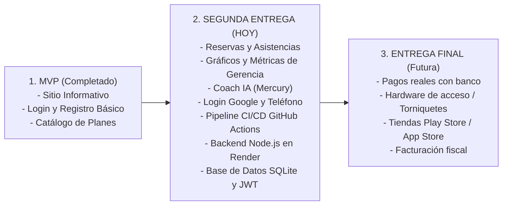

# Delimitación de Alcance: MVP vs Segunda Entrega vs Entrega Final

**Proyecto:** espacioGYM (GROM 21)  
**Materia:** Seminario / Tesina  
**Fecha de Referencia de Segunda Entrega:** Noviembre 2026  

---

## 1. El MVP (Entrega 1 - Lo que ya debió haberse hecho)

El **Producto Mínimo Viable (MVP)** representó la línea base funcional que demostró la viabilidad técnica y operativa del sistema. Su objetivo era permitir que un usuario conociera el gimnasio y gestionara lo más elemental de su cuenta.

### Alcance Concluido en el MVP:
* **Sitio Público Básico (Sprint 1 inicial):**
  * Landing page con información institucional de GROM 21.
  * Horarios de atención y consulta de ubicación física.
  * Enlaces a redes sociales y presentación de entrenadores.
* **Autenticación y Cuentas Básica:**
  * Registro e inicio de sesión tradicional con correo y contraseña.
  * Visualización y edición básica del perfil del socio.
* **Visualización de Planes:**
  * Catálogo de membresías y servicios generales sin automatizaciones complejas.

> **Resumen del MVP:** Una plataforma web informativa con autenticación funcional y visualización estática de catálogos y perfil de socio.

---

## 2. Segunda Entrega (Avance Actual - Lo que exige la Rúbrica)

De acuerdo con la rúbrica oficial de evaluación para el avance de proyecto, la **Segunda Entrega NO es el proyecto final ni terminado**. Exige **avances significativos respecto al MVP** sustentados en arquitectura, integración de servicios, seguridad y CI/CD:

### Requerimientos de la Rúbrica y lo Implementado:

1. **Avances con respecto al MVP (Mapeo de Historias de Usuario):**
   * **Módulo de Agendamiento y Asistencias:** Formularios funcionales para agendar entrenamientos (`/f2`), registrar asistencias (`/f3`) y consulta del historial de actividad (`/actividad`).
   * **Panel de Control Gerencial / Admin:** Visualización de métricas y gráficos (`/graficos`) sobre afluencia por día y ocupación de horarios para toma de decisiones gerenciales.
   * **Coach IA de Entrenamiento:** Asistente virtual impulsado por modelos de lenguaje (Mercury / Inception Labs) para generación automatizada de rutinas y chat interactivo con coaches (`/coach-ia`).
   * **Autenticación Multicanal:** Soporte para inicio de sesión con Google (Google Identity Services) y acceso mediante teléfono móvil para demostración.

2. **Pipeline de Integración Continua (GitHub Actions):**
   * Pipeline automatizado en `.github/workflows/ci.yml` ejecutando:
     * Compilación de producción (Angular 19).
     * Pruebas unitarias automatizadas (Karma + Jasmine).
     * Pruebas de integración.
     * Auditoría de seguridad y análisis estático (SAST / linter).
     * Despliegue continuo (CD) hacia GitHub Pages.

3. **Servicios Web y Backend:**
   * API REST en Node.js/Express desplegada en la nube (Render).
   * Middleware de registro de tráfico HTTP en tiempo real.
   * Rate limiting para mitigación de abuso en endpoints de IA.
   * Integración de servicios externos (servicios de correo/notificación y APIs de inferencia de IA).

4. **Estructura de Base de Datos:**
   * Motor relacional ligero (SQLite con `better-sqlite3`) para gestión de usuarios, roles (`admin` y `user`) y proveedores de autenticación.
   * Almacenamiento local desacoplado para persistencia de sesiones y agendas en cliente.

5. **Arquitectura y Modularidad PWA (Mobile Ready):**
   * Estructura modular preparada para consumo móvil (PWA con Web Manifest, Service Worker y diseño responsivo adaptativo).
   * Separación por capas: Capa de Entrada (`app.routes`), Capa de Datos (`data-access/`), Lógica de Dominio (`models/` y guards) e Interfaz de Usuario (`ui/` y páginas).

6. **Opciones de Seguridad Implementadas:**
   * Cifrado en tránsito (HTTPS obligatorio en GitHub Pages y Render).
   * Autenticación basada en tokens JWT con expiración definida.
   * Control de acceso basado en roles (RBAC: rol `admin` para métricas y rol `user` para clientes).
   * Restricción y aislamiento de endpoints sensibles (acceso restringido a modelos de IA).
   * Hasheo unidireccional de credenciales con saltos criptográficos (`bcryptjs`).

---

## 3. Entrega Final (Lo que NO está hecho y NO se debe hacer todavía)

Para esta segunda entrega **NO se debe implementar el alcance final**. Todo lo siguiente pertenece exclusivamente al cierre definitivo de la tesina y queda fuera del alcance actual:

| Característica / Módulo | Estado para la 2da Entrega | Motivo / Alcance de Entrega Final |
| :--- | :---: | :--- |
| **Pasarela de pagos en vivo (Stripe / Mercado Pago real)** | ❌ **No hacer** | Requiere contratos comerciales, cuentas fiscales validadas y cumplimiento PCI-DSS real. En esta etapa solo se simulan estados de cuenta y comprobantes. |
| **Torniquetes / Control de acceso físico automatizado por hardware** | ❌ **No hacer** | Integración con molinetes físicos, lectores de huella o torniquetes RFID del gimnasio. |
| **App nativa empaquetada en tiendas (Google Play Store / Apple App Store)** | ❌ **No hacer** | Para el avance se evalúa como PWA responsiva multiplataforma (Mobile Web). La publicación en tiendas oficiales es fase de cierre. |
| **Notificaciones Push masivas en segundo plano (WebPush VAPID)** | ❌ **No hacer** | La entrega actual cubre notificaciones transaccionales y confirmaciones. Campañas de marketing masivas quedan para el final. |
| **Módulo contable completo y facturación electrónica (CFDI)** | ❌ **No hacer** | Fuera del alcance del MVP y de la segunda entrega; corresponde a módulos administrativos avanzados de la versión final. |
| **Gestión de inventario y punto de venta (POS) para cafetería/tienda** | ❌ **No hacer** | El foco de la segunda entrega está en entrenamientos, reservas, membresías y analítica gerencial. |

---

## 4. Resumen Ejecutivo para la Presentación

