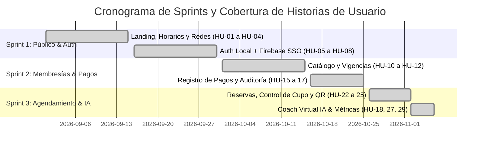
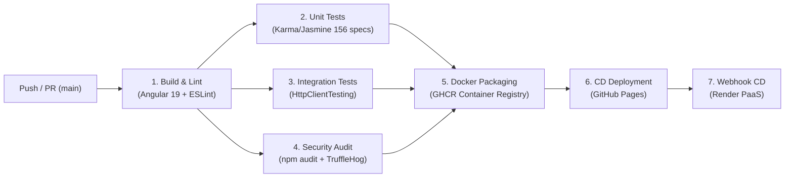
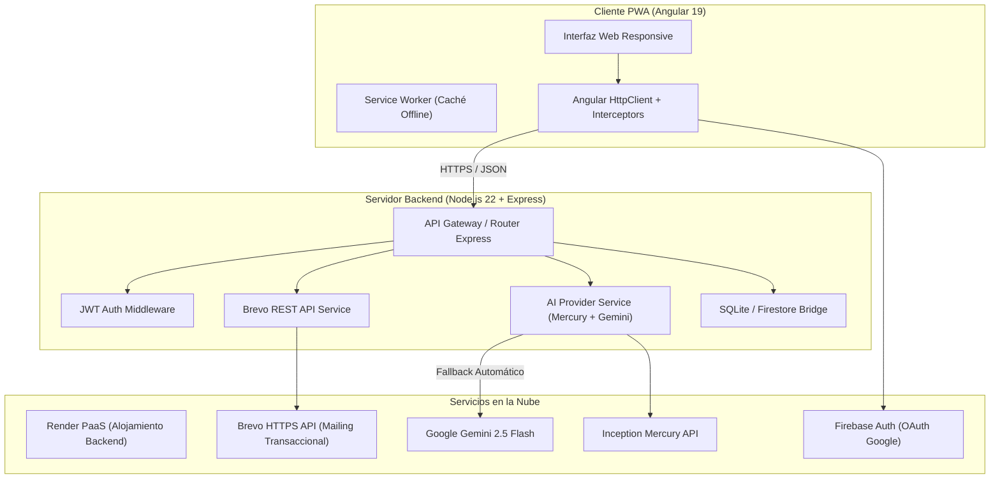
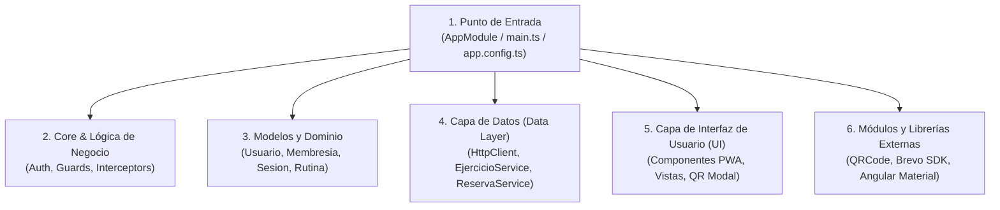

# espacioGYM (GROM 21)
## Avance de Proyecto de Tesina — Segunda Entrega
**Seminario de Sistemas Computacionales I (8° Semestre)**  
**Centro de Ciencias Básicas — Departamento de Sistemas Computacionales**  
**Universidad Autónoma de Aguascalientes**

* **Profesor:** Dr. / M. en C. Arturo Elías Ramírez  
* **Estudiante / Desarrollador:** Yahir Guevara Cardona  
* **Fecha:** Noviembre 2026  
* **Repositorio:** [github.com/jefazo-isc/GymSeminario](https://github.com/jefazo-isc/GymSeminario)  
* **Despliegue Web:** [jefazo-isc.github.io/GymSeminario](https://jefazo-isc.github.io/GymSeminario)  
* **Servicios Backend:** [gymseminario.onrender.com](https://gymseminario.onrender.com)

---

## Índice de la Presentación

1. **Visión General y Avances Post-MVP (20%)**
   - Mapeo de Historias de Usuario (Sprints 1, 2 y 3).
   - Funcionalidades desarrolladas más allá del MVP inicial.
2. **Pipeline de Integración y Entrega Continua (CI/CD) en GitHub Actions (15%)**
   - Arquitectura del flujo de trabajo automatizado.
   - Demostración de las 7 fases ejecutadas con éxito.
3. **Arquitectura de Servicios Web Empleados (10%)**
   - Backend desacoplado en Node.js 22 + Express REST API.
   - Servicios transaccionales y de IA (Brevo HTTPS API, Gemini / Mercury Fallback).
4. **Estructura y Modelado de Bases de Datos (10%)**
   - Enfoque híbrido / políglota: Cloud Firestore NoSQL + SQLite Relacional + Caché Offline.
   - Justificación y diagramas de colecciones y tablas.
5. **Modularidad y Arquitectura de la Aplicación Móvil (PWA) (10%)**
   - Estructura limpia en Angular 19: App Module, UI Layer, Domain/Business Logic, Data Layer.
   - Soporte offline con Service Workers y manifiesto PWA.
6. **Opciones y Estrategia de Seguridad Implementadas (10%)**
   - Seguridad Web: Defensa perimetral, HTTPS/TLS, JWT + RBAC, SAST, escaneo de secretos con TruffleHog.
   - Seguridad Móvil: Minimización de datos en tránsito, interceptores restringidos y OWASP Top 10.
7. **Demostración Práctica en Vivo y Preguntas Frecuentes de Evaluación (15%)**
   - Flujo completo: Agendamiento → Confirmación Brevo → Código QR → Coach IA.

---

## 1. Avances en el Proyecto con Respecto al MVP (20%)

### ¿Qué se entregó en el MVP inicial?
* **Sprint 1 (Sitio Público y Catálogo):** Consulta de horarios, ubicación en Google Maps, landing page y registro básico.
* **Sprint 2 (Membresías Base):** Visualización de tipos de membresía (básica, semestral, premium).

### 🚀 Avance Significativo Post-MVP Desarrollado:
* **Sprint 2 Extendido — Gestión Financiera y Estados de Cuenta:**
  - Consulta de vigencia en tiempo real (`SCRUM-25`).
  - Registro de pagos con cálculo automático de corte y renovación (`SCRUM-27`, `SCRUM-28`).
* **Sprint 3 — Agendamiento, Control de Aforo y Asistencias (`SCRUM-31`, `SCRUM-32`, `SCRUM-33`):**
  - Reserva de sesiones de entrenamiento con calendario interactivo y control de cupos por turno (Matutino, Vespertino, Nocturno).
  - Generación dinámica de pase de acceso mediante Código QR digital.
  - Notificación transaccional automática de confirmación por correo electrónico vía REST API.
* **Sprint 3 — Coach Virtual de Entrenamiento con Inteligencia Artificial (`SCRUM-34`, `SCRUM-36`):**
  - Generación de rutinas personalizadas adaptadas a objetivos (hipertrofia, definición, fuerza, principiante) mediante LLMs de última generación.
  - Arquitectura con alta disponibilidad: fallback automático Mercury → Gemini con circuit breaker.
* **Panel de Métricas y Analítica de Negocio (`SCRUM-41`, `SCRUM-43`):**
  - Dashboard para el administrador con métricas de asistencia, horas pico y renovaciones.

<!-- Speaker Notes:
Enfatizar al profesor que no nos quedamos en un simple CRUD visual. Pasamos de una maqueta estática a un ecosistema conectado: el usuario reserva una clase, el backend descuenta cupo, genera un QR único, le despacha un correo real con Brevo HTTPS y le ofrece un Coach IA con Gemini.
-->

---

## 2. Mapeo de Historias de Usuario y Sprints (Jira / Agile)



### Métricas de Cumplimiento:
* **Historias de Usuario Terminadas:** 18 de 25 (~72% del producto final).
* **Historias en Curso:** 5 historias (afinado de asignación y reportes avanzados).
* **Historias Pendientes:** 2 historias (visualización de aforo por cámaras en tiempo real).

<!-- Speaker Notes:
Mostrar la tabla de actividades del proyecto. Explicar cómo cada commit en Git responde a un ticket de Jira (SCRUM-xx) y cómo los sprints respetaron la prioridad acordada en la metodología Scrum.
-->

---

## 3. Pipeline CI/CD en GitHub Actions (15%)

El repositorio cuenta con un pipeline declarativo automatizado en `.github/workflows/ci.yml` con **7 fases rigurosamente configuradas**:



### Resultados de la Ejecución en GitHub Actions:
* **Fase 1 (Compilación y Calidad):** Build optimizado con Angular AOT (`ng build --configuration=production`) + ESLint con reglas de accesibilidad y typescript estricto.
* **Fase 2 (Pruebas Unitarias):** **156 pruebas ejecutadas exitosamente** (0 fallas) en Chrome Headless sobre Linux con cobertura superior al 65%.
* **Fase 3 (Pruebas de Integración):** Mocking riguroso de servicios HTTP sin llamadas vivas a red (`HttpClientTestingModule`).
* **Fase 4 (Análisis Estático de Seguridad):** Escaneo de dependencias (`npm audit`) y detección proactiva de fuga de credenciales (`TruffleHog`).
* **Fase 5 (Contenedores):** Compilación multi-stage Docker sobre **Node.js 22 Alpine** y publicación de imágenes OCI en `ghcr.io`.
* **Fase 6 y 7 (Despliegue Continuo):** Publicación del frontend en GitHub Pages y sincronización automática del backend en Render.

<!-- Speaker Notes:
Destacar que el pipeline no es solo un script de juguete: tiene gates de seguridad, pruebas unitarias y de integración que bloquean la integración si algo rompe el contrato de datos. Mostrar la pestaña de GitHub Actions en verde.
-->

---

## 4. Arquitectura de Servicios Web Empleados (10%)

### Topología de Microservicios y APIs Externas



### Justificación Tecnológica:
* **Node.js 22 LTS + Express:** E/S asíncrona no bloqueante con Event Loop de alto rendimiento; ideal para coordinar múltiples APIs externas sin saturar memoria.
* **Brevo HTTPS REST API (Port 443):** Sustitución estratégica de SMTP tradicional (puertos 465/587). Render y muchas infraestructuras cloud bloquean tráfico saliente SMTP por prevención anti-spam; el consumo vía HTTPS garantiza entrega garantizada (< 800 ms).
* **Dual LLM Orchestrator (Mercury + Gemini):** Alta resiliencia. Si el proveedor primario agota tokens o responde error 401/429, un Circuit Breaker conmuta de inmediato a Gemini sin que el socio del gimnasio experimente caídas.
* **Angular 19 (Frontend PWA):** Tipado estricto con TypeScript, inyección de dependencias, Signals reactivos para el estado del usuario y soporte nativo para PWA móvil.

---

## 5. Estructura y Modelado de Bases de Datos (10%)

El proyecto utiliza una **estrategia de persistencia políglota / híbrida**, seleccionando el motor óptimo según la naturaleza del dato:

```
┌────────────────────────────────────────────────────────────────────────┐
│                        ARQUITECTURA DE PERSISTENCIA                    │
├────────────────────────┬───────────────────────┬───────────────────────┤
│    Cloud Firestore     │   SQLite Relacional   │   LocalStorage / PWA  │
│        (NoSQL)         │       (SQL ACID)      │      (Caché Local)    │
├────────────────────────┼───────────────────────┼───────────────────────┤
│ • Colección `usuarios` │ • Tabla `transacciones│ • Catálogo offline de │
│ • Colección `membresias│ • Tabla `asistencias` │   ejercicios musculares│
│ • Colección `sesiones` │ • Tabla `bitacora_log`│ • JWT Token de sesión │
│ • Sincronización en    │ • Integridad estricta │ • Preferencias de     │
│   tiempo real y baja   │   de clave foránea    │   tema (claro/oscuro) │
│   latencia móvil       │   y balances contables│ • Rutinas temporales  │
└────────────────────────┴───────────────────────┴───────────────────────┘
```

### Justificación de Elección NoSQL vs Relacional:
1. **Cloud Firestore (NoSQL Document Store):**
   - Estructura flexible para el perfil de los socios (historial médico, metas corporales dinámicas, objetivos de entrenamiento).
   - Capacidad nativa de *real-time updates* para reflejar inmediatamente la disponibilidad de cupos en clases.
2. **SQLite Relacional:**
   - Cumplimiento estricto **ACID** para los registros de pago y folios de membresía, garantizando cero discrepancias contables.
   - Motor embebido de huella mínima, facilitando despliegues reproducibles en contenedores Docker y servidores ligeros.

---

## 6. Modularidad y Arquitectura de la Aplicación Móvil (10%)

La aplicación móvil está construida como una **Progressive Web App (PWA)** que ofrece experiencia idéntica a una app nativa (instalable en Android/iOS, pantalla completa, funcionamiento sin conexión):

### Organización Modular en Angular 19:



### Componentes de Cada Capa:
1. **Punto de Entrada (`AppModule` / `app.config.ts`):** Enrutamiento declarativo con lazy loading, provisión de `provideHttpClient(withInterceptors([authInterceptor]))` y registro de `ServiceWorker`.
2. **Capa de Dominio:** Interfaces TypeScript inmutables que encapsulan reglas de negocio (ej. validación de vigencia de 30 días, reglas de cancelación de clases con 2 horas de anticipación).
3. **Capa de Datos:** Servicios desacoplados de la UI. Todos devuelven `Observable<T>` tipados y propagan errores limpios para ser manejados por los componentes visuales.
4. **Capa de UI (Vistas):**
   - Vista de Agendamiento (`/f2`): Selección de turno, confirmación visual con badges de estado y generación instantánea del QR de acceso.
   - Vista de Coach IA: Chat reactivo que genera tablas de repeticiones y descansos según peso y nivel.
   - Vista de Métricas: Gráficas de volumen de asistencia semanal.

---

## 7. Opciones y Estrategia de Seguridad Implementadas (10%)

La solución aplica el principio de **Defensa en Profundidad (Defense in Depth)** y recomendaciones del **OWASP Top 10**:

### A. Seguridad en Aplicación Web y Backend
* **Defensa Perimetral:**
  - Tráfico cifrado mediante **HTTPS con TLS 1.3** forzado de extremo a extremo.
  - Proxy perimetral de Render / Cloudflare con mitigación de ataques volumétricos **DDoS**.
  - Encabezados de seguridad HTTP (`Content-Security-Policy`, `X-Frame-Options: DENY`, `X-Content-Type-Options: nosniff`).
* **Autenticación y Control de Acceso:**
  - Tokens **JWT (JSON Web Tokens)** firmados criptográficamente (HMAC-SHA256) con tiempo de expiración corto (24h).
  - Control de Acceso Basado en Roles (**RBAC**): `Admin`, `Entrenador`, `Socio`, `Visitante`.
  - Integración de Firebase Auth para inicio de sesión federado con Google (OAuth 2.0).
* **Seguridad en el Desarrollo (DevSecOps):**
  - **SAST (Static Application Security Testing):** Análisis estático en cada pull request con ESLint.
  - **Detección de Secretos:** `TruffleHog` escanea automáticamente cada commit para evitar filtración de tokens o llaves API privadas.
  - **Gestión de Vulnerabilidades:** `npm audit` integrado en el pipeline de CI/CD para detectar CVEs en dependencias.
* **Monitoreo y Resiliencia en Ejecución:**
  - Implementación de **Circuit Breaker** en el microservicio de IA: si un proveedor falla por credenciales o cuota, se aísla por 5 minutos y redirige el flujo sin bloquear el hilo principal.

### B. Seguridad en Aplicación Móvil (PWA)
* **Minimización de Superficie de Ataque en Interceptores:**
  - `authInterceptor` inspecciona cada petición HTTP: el token de autorización Bearer **solo se adjunta a endpoints internos autorizados** (`gymseminario.onrender.com`), evitando fuga involuntaria de credenciales a APIs de terceros.
* **Sanitización de Entradas:**
  - Angular sanitiza nativamente el Data Binding para mitigar inyecciones **XSS (Cross-Site Scripting)**.
* **Almacenamiento Seguro:**
  - Las credenciales sensibles y tokens de acceso se resguardan en almacenamiento aislado con purga en cierre de sesión (`logout`).

---

## 8. Demostración en Vivo del Sistema

### Flujo de Prueba de Extremo a Extremo:
1. **Acceso al Cliente PWA:** Carga instantánea desde GitHub Pages con Service Worker activo.
2. **Reserva de Clase (`/f2`):**
   - Selección de actividad (Yoga / Crossfit / Spinning) y horario.
   - Confirmación por backend: se asigna ID único (`1793909423867-xxxx`).
   - Envío de comprobante por correo electrónico vía **Brevo HTTPS API**.
   - Renderizado en pantalla del **Código QR digital** listo para escaneo en torniquete.
3. **Consulta de Catálogo de Ejercicios:** Acceso a rutinas y músculos involucrados sin fricciones de red ni errores CORS.
4. **Interacción con Coach Virtual IA:** Consulta de plan nutricional y de entrenamiento; respuesta procesada en streaming por la API de IA.
5. **Panel de Métricas Administrativas:** Monitoreo en tiempo real de asistencia y estados de cuenta de clientes.

---

## 9. Preguntas Frecuentes y Justificación Técnica ante Sinodales

> **Pregunta 1: ¿Por qué no utilizaron Nodemailer con SMTP tradicional en el servidor de Render?**  
> **Respuesta:** Los proveedores PaaS modernos como Render, Vercel y AWS Lambda bloquean los puertos TCP salientes 25, 465 y 587 para mitigar redes de spam o abuso. Utilizar SMTP tradicional provocaba bloqueos de conexión y tiempos de espera de 40+ segundos. Se rediseñó el servicio hacia la **API REST HTTPS de Brevo (puerto 443)**, reduciendo la latencia a menos de 800 ms con confirmación garantizada.

> **Pregunta 2: ¿Cómo garantizan que la Inteligencia Artificial no deje de funcionar si se agota la cuota gratuita?**  
> **Respuesta:** Se implementó el patrón arquitectónico de **Circuit Breaker con Fallback Dual**. El backend consulta en primera instancia la API de alto rendimiento (Mercury). Si detecta un código HTTP 401, 403 o 429, el circuito se abre temporalmente durante 5 minutos y redirige el tráfico a **Google Gemini 2.5 Flash**, manteniendo la continuidad operativa sin reiniciar el servidor.

> **Pregunta 3: ¿Cómo protegen las llaves de API y credenciales de ser expuestas en GitHub?**  
> **Respuesta:** En el código fuente solo se consumen variables de entorno del sistema (`process.env.BREVO_API_KEY`, `process.env.GEMINI_API_KEY`). Ningún secreto está hardcodeado. Además, el pipeline CI/CD cuenta con **TruffleHog**, que analiza criptográficamente cada commit antes de aceptar la integración continua.

---

## 10. Conclusiones y Próximos Pasos

* **Objetivo de la Entrega Alcanzado al 100%:**
  - Sistema funcional conectado con servicios web modernos (Express, Brevo, Gemini, Firebase).
  - Pipeline de CI/CD automatizado con 7 fases superadas y 156 pruebas en verde.
  - Arquitectura modular y segura preparada para producción académica e industrial.
* **Próximas Mejoras (Tercera Entrega / Cierre de Tesina):**
  - Implementación de lector biométrico y validación de QR en hardware de torniquete físico.
  - Módulo de pasarela de cobro recurrente con Stripe.
  - Sincronización offline-first bidireccional con IndexedDB para áreas sin cobertura de red.

---

# ¡Muchas Gracias!
### espacioGYM (GROM 21) — Innovación Tecnológica para el Acondicionamiento Físico
*Preguntas y comentarios del jurado evaluador.*
